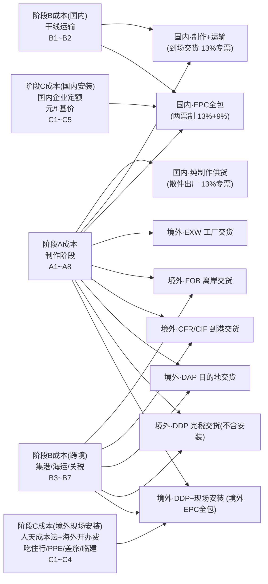
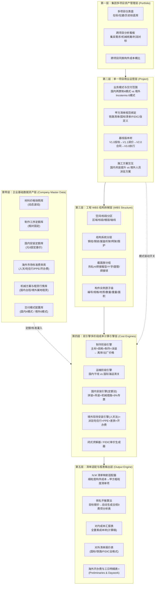
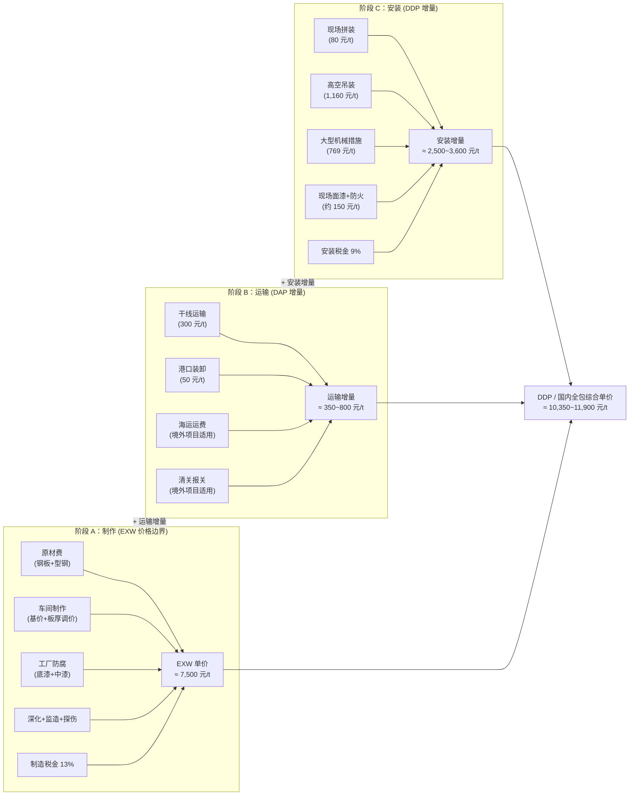
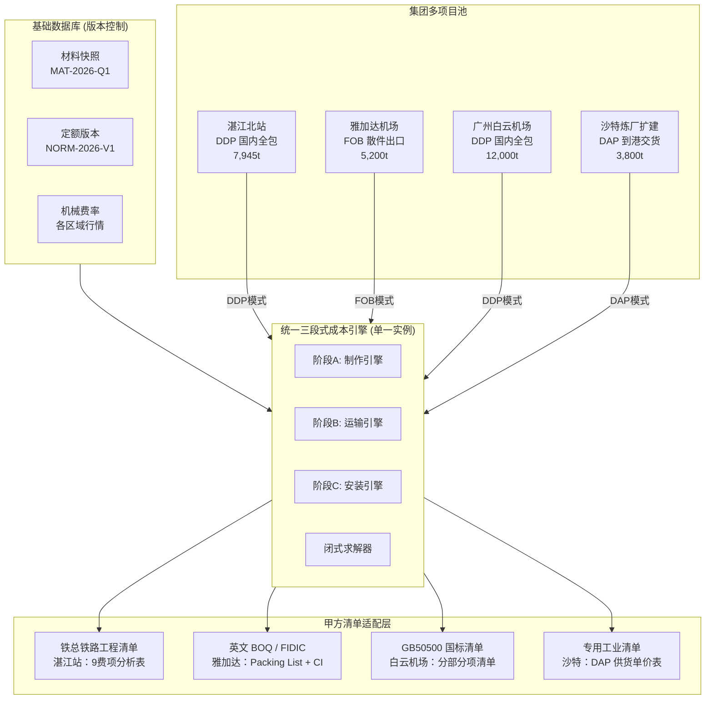

# 企业级钢结构商务估价与成本管理系统：多层次总体架构设计规范（完整版）

---

## 一、 四轴分离、五层联动的总体架构思想

本系统围绕四条核心设计轴，彻底解构传统 Excel DIY 的混乱状态：

| 设计轴 | 解决的核心问题 |
|:------|:-------------|
| **① 纵向层级轴** | 多项目 → 单项目 → 构件级的穿透式拆解与上卷汇总 |
| **② 横向清单适配轴** | 一套成本计算，自动对接甲方 N 种不同格式的商务清单 |
| **③ 时间版本控制轴** | 材料价格动态波动与稳定定额的解耦，支持多项目并发重算 |
| **④ 交付模式轴** | 按"制作 / 运输 / 安装"阶段分拆，完整对应国际贸易 Incoterms 术语 |

---

## 二、 交付模式轴：国内分阶段结算与国际贸易术语的统一模型

> [!IMPORTANT]
> **业务模式严格分离原则**：国内业务与境外出口业务在税务逻辑、成本构成与计价标准上存在根本差异：
> - **国内业务**：受中国税法约束，采用"两票制"机制（制作 13% 货物专票 + 安装 9% 建安劳务专票），现场安装套用成熟的**企业定额（元/t 固定基价）**；
> - **境外业务**：采用国际通用 Incoterms 2020 术语，计价币种通常为美金或当地币。**境外现场安装绝不能盲目套用国内定额**，因海外新兴市场的劳工政策、工效环境截然不同，必须基于**人员派驻人天成本法（Man-Day Rate Model）**与**海外开办费（Site Mobilization & Preliminaries）**进行精细测算。

### 1. 三阶段成本解剖

每一吨钢结构构件，从原材料到最终就位，经历严格的三段成本链：

```
━━━━━━━━━━━━━━━━━━━━━━━━━━━━━━━━━━━━━━━━━━━━━━━━━━━━━━━━━━━━━━━━━━━━━━━━━━━━━━━━━
            [阶段 A: 制作]                 [阶段 B: 运输/清关]           [阶段 C: 现场安装]
━━━━━━━━━━━━━━━━━━━━━━━━━━━━━━━━━━━━━━━━━━━━━━━━━━━━━━━━━━━━━━━━━━━━━━━━━━━━━━━━━
原材采购                       工厂出厂                     到达施工现场              构件空中就位
    │                              │                            │                         │
 A1 钢材主材 + 损耗              │                            │                         │
 A2 车间制作基价                 │  【国内模式】               【国内安装 · 定额法】       │
 A3 板厚/规格调价                B1 长途干线公路运输           C1 现场拼装人工与辅材     │
 A4 工艺板与加劲肋               B2 现场二次倒运与卸货         C2 高空吊装定额基价       │
 A5 工厂防腐底漆+中漆            │                            C3 大型机械措施(履带吊)   │
 A6 深化设计与建模               │  【境外出口模式】           C4 现场防火涂料/面漆      │
 A7 厂内探伤与第三方监造         B3 出口集港与口岸操作         C5 境内建安专票(9%)       │
 A8 工厂自产货物专票(13%)        B4 国际海运干线运费及保费     │                         │
                                 B5 目的港港杂与进口清关       【境外现场安装 · 人天成本法】⭐
                                 B6 进口关税与报关规费         C1 派驻人员综合人天工日   │
                                 B7 目的国内陆短驳至现场       C2 往返国际差旅与签证     │
                                                               C3 属地化起重机械设备租赁 │
                                                               C4 境外开办费包(临建/准入)│
━━━━━━━━━━━━━━━━━━━━━━━━━━━━━━━━━━━━━━━━━━━━━━━━━━━━━━━━━━━━━━━━━━━━━━━━━━━━━━━━━
```

### 2. 交付模式 × 成本边界对照映射表

系统内置"业务模式与交付范围"开关，驱动底层计算引擎与数据库标准的智能切换：



### 3. 各交付模式的成本边界与典型适用场景

| 业务模式 | 交付术语 / 范围 | 包含成本科目 | 价格边界点 | 适用典型场景 |
|:--------|:---------------|:-----------|:---------|:-----------|
| **国内业务** | **模式1：纯制作供货** | 阶段 A (制作全部) | 工厂大门口 | 业主/总包自提、甲方自行分包运输与安装 |
| **国内业务** | **模式2：制作 + 运输** | 阶段 A + 阶段 B (国内运费) | 施工现场地面 | 送货到施工现场，总包自行负责安装就位 |
| **国内业务** | **模式3：制作 + 安装** | 阶段 A + 阶段 C (两票制) | 现场就位 (运费含在制造票) | 典型钢结构专业分包模式 |
| **国内业务** | **模式4：EPC 全包** | 阶段 A + B + C (制作+运+安) | 构件空中就位 | 大型工程总承包（如湛江北站、机场航站楼） |
| **境外业务** | **EXW** (工厂交货) | 仅阶段 A (制作全部) | 工厂大门口 | 国际贸易商自提、外商自理报关海运 |
| **境外业务** | **FOB** (离岸价) | 阶段 A + B3 (出口集港装船) | 离港船舷 | 钢构离岸出口（最常见的标准出口贸易模式） |
| **境外业务** | **CFR / CIF** (成本加运费/保费) | 阶段 A + B3~B4 (国际海运) | 目的港码头交货 | 承担海运但由外方负责当地清关与内陆运输 |
| **境外业务** | **DAP** (目的地交货) | 阶段 A + 阶段 B (全程内陆) | 境外现场地面 (未清关) | 跨国供货至海外工地，外商自行清关交税 |
| **境外业务** | **DDP (不含安装)** | 阶段 A + 阶段 B 全程含税 | 境外现场地面 (已完税) | 供货到海外现场，买方自有施工队伍安装 |
| **境外业务** | **DDP + 现场安装 (境外EPC)** ⭐ | 阶段 A + B + **阶段 C 境外安装** | 境外构件空中安装就位 | 东南亚/中东/非洲钢结构 EPC 交钥匙工程 |

---

### 4. 境外现场安装与海外开办费计算模型（人天成本法）

> [!TIP]
> 针对海外新兴市场，**严禁套用国内定额**。系统采用"人天成本法"与"开办费专项包"，建立科学、可量化的境外施工报价模型：

#### ① 现场派驻人员综合日费率（Man-Day Standard Rate）
$$C_{\text{day\_rate}} = S_{\text{base}} + A_{\text{hardship}} + M_{\text{meal}} + H_{\text{hotel}} + T_{\text{traffic}} + \frac{P_{\text{PPE}}}{D_{\text{project}}} + \frac{I_{\text{insurance}}}{30}$$

- $S_{\text{base}}$：国内派出技术工人基本日工资（元/天）；
- $A_{\text{hardship}}$：驻外艰苦津贴与外派补贴（元/天，按国别标准库 Tier 1~4 划分）；
- $M_{\text{meal}}$：每日伙食补助费（企业派驻标准，元/天）；
- $H_{\text{hotel}}$：每日现场营地住宿/租房分摊费（元/天）；
- $T_{\text{traffic}}$：现场往返通勤交通费（元/天）；
- $P_{\text{PPE}}$：劳保用品与安全防护全套包（元/人/套，包含防砸鞋、国标安全帽、五点式双大钩安全带、防坠器、特殊气候劳保包等），按工期天数 $D_{\text{project}}$ 摊销；
- $I_{\text{insurance}}$：国际紧急救援 (SOS) 与海外人身意外险（元/人/月）。

#### ② 境外现场安装总费用构成
$$C_{\text{overseas\_install\_total}} = \sum_{k=1}^{M} \left( N_k \times D_k \times C_{\text{day\_rate}, k} \right) + N_{\text{total}} \times (F_{\text{flight}} + V_{\text{visa}}) + C_{\text{machinery\_local}} + C_{\text{preliminaries}}$$

- **安装人工费**：$M$ 个工种（工长、高空安装工、持证焊工、机修工、安全员等），各工种人数 $N_k \times$ 现场工期天数 $D_k \times$ 该工种日综合费率；
- **国际差旅及签证**：总派驻人数 $N_{\text{total}} \times$ (往返国际机票 $F_{\text{flight}}$ + 签证体检居留许可 $V_{\text{visa}}$)；
- **属地化机械设备租赁**：$C_{\text{machinery\_local}}$（目的国本地租赁汽车吊、随车吊、柴油发电机组等月租及燃油维护费）；
- **海外现场开办费 (Site Mobilization & Preliminaries)**：$C_{\text{preliminaries}}$（目的国营地建设/集装箱办、现场临时水电接驳、临时堆场租赁、属地公司准入执照/法律劳工合规费用等）。

#### ③ 报价输出机制（双轨制）
- **单价摊销法**：$C_{\text{overseas\_install\_unit}} = \frac{C_{\text{overseas\_install\_total}}}{W_{\text{total\_weight}}}$（元/t），将境外安装与开办费平摊到每一项钢构构件中；
- **清单分列法 (FIDIC 规范)**：将阶段 A+B 列为永久工程材料清单（Permanent Works），阶段 C 及开办费列为**通用项/开办费清单（General Items / Preliminaries）**与**计日工单价表（Daywork Schedule）**。

---

## 三、 五层纵向架构详解



---

## 四、 交付模式下的成本科目启停控制矩阵

系统通过**业务模式与成本科目启停标志 (Cost Item Activation Flag)** 实现自动适配，国内与境外严格分离：

| 成本科目分类 | 细分费用科目 | 国内纯制作 | 国内EPC全包 | 境外EXW | 境外FOB | 境外DAP | 境外DDP(不含安) | 境外DDP+现场安装(EPC) ⭐ |
|:------------|:-----------|:---------:|:----------:|:-------:|:-------:|:-------:|:--------------:|:----------------------:|
| **阶段A (制作)** | A1 钢材主材 + 损耗 | ✅ | ✅ | ✅ | ✅ | ✅ | ✅ | ✅ |
| | A2~A5 车间制作与调价 | ✅ | ✅ | ✅ | ✅ | ✅ | ✅ | ✅ |
| | A6 工厂防腐涂装 (底中漆) | ✅ | ✅ | ✅ | ✅ | ✅ | ✅ | ✅ |
| | A7 深化设计与探伤监造 | ✅ | ✅ | ✅ | ✅ | ✅ | ✅ | ✅ |
| | A8 自产货物增值税 13% | ✅ | ✅ (制造票) | ❌(退税/零税) | ❌ | ❌ | ❌ | ❌ |
| **阶段B (物流清关)**| B1 国内长途干线运费 | ❌ | ✅ | ❌ | ✅(集港) | ❌ | ❌ | ❌ |
| | B2 国际海运费与货运保险 | ❌ | ❌ | ❌ | ❌ | ✅ | ✅ | ✅ |
| | B3 目的港清关与关税规费 | ❌ | ❌ | ❌ | ❌ | ❌ | ✅ | ✅ |
| | B4 目的国内陆短驳运费 | ❌ | ❌ | ❌ | ❌ | ✅ | ✅ | ✅ |
| **阶段C (国内安装)**| C_DOM 现场拼装与高空吊装 (定额) | ❌ | ✅ | ❌ | ❌ | ❌ | ❌ | ❌ |
| | C_DOM 大型机械措施 (履带吊/提升) | ❌ | ✅ | ❌ | ❌ | ❌ | ❌ | ❌ |
| | C_DOM 境内建安专票 9% | ❌ | ✅ (安装票) | ❌ | ❌ | ❌ | ❌ | ❌ |
| **阶段C (境外安装)**| **C_INT1 派驻人员吃住行及津贴 (人天法)** | ❌ | ❌ | ❌ | ❌ | ❌ | ❌ | ✅ ⭐ |
| | **C_INT2 劳保用品 (PPE) 专项配置摊销** | ❌ | ❌ | ❌ | ❌ | ❌ | ❌ | ✅ ⭐ |
| | **C_INT3 往返国际机票与签证体检** | ❌ | ❌ | ❌ | ❌ | ❌ | ❌ | ✅ ⭐ |
| | **C_INT4 境外现场开办费 (Preliminaries)** | ❌ | ❌ | ❌ | ❌ | ❌ | ❌ | ✅ ⭐ |
| | **C_INT5 境外属地化起重机械租赁** | ❌ | ❌ | ❌ | ❌ | ❌ | ❌ | ✅ ⭐ |
| **间接费与利润** | D1 管理费与规费 | ✅ | ✅ | ✅ | ✅ | ✅ | ✅ | ✅ |
| | D2 目标利润 | ✅ | ✅ | ✅ | ✅ | ✅ | ✅ | ✅ |

---

## 五、 单项目内三阶段成本拆分视图

在同一个 DDP 全包项目内部，三阶段成本相互独立核算，可单独提取各阶段的利润率，也可以单独对某阶段进行分包询价对比：



### 各阶段成本作为独立分包询价基准

在实际商务操作中，这三阶段可以灵活拆分发包：

| 分包决策场景 | 对应发包阶段 | 系统输出内容 |
|:-----------|:-----------|:-----------|
| 自营工厂制作 + 自营运输 + 自营安装 | A+B+C 全自营 | 全成本汇报 + DDP 报价 |
| 自营工厂制作，外包国内运输，自营安装 | A 自营 + B 询价对比 + C 自营 | B 阶段运输询价分析表 |
| 自营工厂制作，散件出口，买方自行安装 | 仅 A + B 到 FOB | FOB 报价单 + 装箱单 |
| 钢材采购 + 委外加工，自行运输安装 | A1 自营 + A2~A5 外委询价 | 外委制作询价清单 + 对比分析 |

---

## 六、 综合成本计算引擎：三阶段两票制闭式求解

三阶段的成本在进入综合单价求解器前先按两票制归类：

$$C_{\text{制造端}} = A_1 + A_2 + A_3 + A_4 + A_5 + A_6 + A_7$$

$$C_{\text{运输端}} = B_1 + B_2 \quad \text{(国内段，计入制造票)}$$

$$C_{\text{安装端}} = C_1 + C_2 + C_3 + C_4$$

> [!NOTE]
> 国内运输费（B1/B2）通常随制造票一并开具（制造厂代开），计入 13% 税率科目；境外海运和进口关税则是独立采购成本，不在两票制税率体系内，以实际发票据实列支。

**含税综合单价的闭式解（三阶段全包 DDP 模式下）**：

$$CJ_{\text{DDP}} = \frac{(C_{\text{制造端}} + C_{\text{运输端}}) \cdot (1 + \tau_{13\%}) + C_{\text{安装端}} \cdot (1 + \tau_{9\%})}{1 - R_{\text{工艺板}} \cdot (1 + \tau_{13\%}) - (R_{\text{管理}} + R_{\text{利润}}) \cdot (1 + \tau_{9\%})}$$

**不同交付模式的价格提取点**：

$$CJ_{\text{EXW}} = \frac{C_{\text{制造端}} \cdot (1 + \tau_{13\%})}{1 - R_{\text{工艺板}} \cdot (1 + \tau_{13\%}) - (R_{\text{管理}} + R_{\text{利润}}) \cdot (1 + \tau_{13\%})}$$

$$CJ_{\text{FOB}} = CJ_{\text{EXW}} + B_1 + B_2 + B_3 \quad \text{(加：内地运输+装船费)}$$

$$CJ_{\text{DAP}} = CJ_{\text{FOB}} + B_4 + B_5 \quad \text{(加：国际运费+目的地短驳)}$$

$$CJ_{\text{DDP}} = CJ_{\text{DAP}} + B_6 + \frac{C_{\text{安装端}} \cdot (1 + \tau_{9\%})}{1 - (R_{\text{管理}} + R_{\text{利润}}) \cdot (1 + \tau_{9\%})} \quad \text{(加：关税+现场安装)}$$

---

## 七、 多项目与甲方清单适配全景视图



---

## 八、 数据实体模型：交付模式维度扩展

```python
from enum import Enum
from dataclasses import dataclass, field
from typing import Dict, List, Optional

class DeliveryMode(str, Enum):
    """
    交付模式枚举：覆盖国内分阶段模式和国际 Incoterms
    """
    # 国内分阶段模式
    MANUFACTURE_ONLY = "MFG_ONLY"       # 仅制作 (散件出厂)
    MFG_TRANSPORT    = "MFG_TRANS"      # 制作 + 运输到现场
    FULL_EPC         = "FULL_EPC"       # 全包 (制作+运输+安装)
    
    # 国际贸易术语 (Incoterms 2020)
    EXW = "EXW"   # Ex Works - 工厂交货
    FCA = "FCA"   # Free Carrier - 承运人处交货
    FOB = "FOB"   # Free On Board - 离岸价
    CFR = "CFR"   # Cost and Freight - 成本加运费
    CIF = "CIF"   # Cost, Insurance and Freight - 成本+保险+运费
    DAP = "DAP"   # Delivered at Place - 目的地交货
    DDP = "DDP"   # Delivered Duty Paid - 完税后交货

# 成本科目启停配置
DELIVERY_COST_ACTIVATION: Dict[DeliveryMode, Dict[str, bool]] = {
    DeliveryMode.EXW: {
        "phase_A_manufacturing": True,
        "phase_B_domestic_freight": False,
        "phase_B_port_handling": False,
        "phase_B_export_clearance": False,
        "phase_B_sea_freight": False,
        "phase_B_import_duty": False,
        "phase_C_installation": False,
        "tax_vat_13pct": True,
        "tax_vat_9pct": False,
    },
    DeliveryMode.FOB: {
        "phase_A_manufacturing": True,
        "phase_B_domestic_freight": True,
        "phase_B_port_handling": True,
        "phase_B_export_clearance": True,
        "phase_B_sea_freight": False,
        "phase_B_import_duty": False,
        "phase_C_installation": False,
        "tax_vat_13pct": True,
        "tax_vat_9pct": False,
    },
    DeliveryMode.DAP: {
        "phase_A_manufacturing": True,
        "phase_B_domestic_freight": True,
        "phase_B_port_handling": True,
        "phase_B_export_clearance": True,
        "phase_B_sea_freight": True,
        "phase_B_import_duty": False,
        "phase_C_installation": False,
        "tax_vat_13pct": True,
        "tax_vat_9pct": False,
    },
    DeliveryMode.DDP: {
        "phase_A_manufacturing": True,
        "phase_B_domestic_freight": True,
        "phase_B_port_handling": True,
        "phase_B_export_clearance": True,
        "phase_B_sea_freight": True,
        "phase_B_import_duty": True,
        "phase_C_installation": True,
        "tax_vat_13pct": True,
        "tax_vat_9pct": True,
    },
    DeliveryMode.FULL_EPC: {
        "phase_A_manufacturing": True,
        "phase_B_domestic_freight": True,
        "phase_B_port_handling": False,
        "phase_B_export_clearance": False,
        "phase_B_sea_freight": False,
        "phase_B_import_duty": False,
        "phase_C_installation": True,
        "tax_vat_13pct": True,
        "tax_vat_9pct": True,
    },
}

@dataclass
class ProjectConfig:
    project_id: str
    project_name: str
    delivery_mode: DeliveryMode        # 核心交付模式开关
    client_bq_template: str            # 甲方清单模板
    material_snapshot_id: str          # 绑定材料价格快照
    norm_version_id: str               # 绑定定额版本
    
    # 运输参数
    factory_to_site_km: float = 0.0    # 国内运距 (km)
    destination_country: str = "CN"    # 目的国 (境外项目)
    sea_route: str = ""                # 海运航线 (境外项目)
    
    # 商务费率参数
    target_profit_rate: float = 0.0    # 目标利润率 (正为盈利，负为让利)
    overhead_rate: float = 0.085       # 公司管理费率
    tax_goods: float = 0.13            # 自产货物增值税率
    tax_construction: float = 0.09     # 建筑安装增值税率
```

---

## 九、 总结：系统核心能力矩阵

| 能力维度 | 核心设计 | 业务价值 |
|:--------|:--------|:--------|
| **多项目管理** | Portfolio + 基线版本树 | 全集团商务资产统一管理，避免数据孤岛 |
| **三阶段成本透明** | 制作/运输/安装独立核算，可单独提取 | 支持灵活发包决策，每阶段利润率清晰可控 |
| **国际贸易适配** | Incoterms 2020 完整映射 + 成本科目启停矩阵 | 一套系统同时支持国内全包与境外 EPC/FOB 出口 |
| **材料价格波动** | 材料快照与构件解耦，版本封存+跨项目重算 | 钢价上涨时，1 秒完成 20 个项目的利润影响分析 |
| **甲方清单适配** | N:M 映射引擎 + 倒轧平衡算法 | 对接铁路/国标/FIDIC/自定义任意格式清单 |
| **无循环引用求解** | 闭式代数精确解析 | 彻底消除 Excel 循环引用和 `#REF!` 崩溃风险 |
