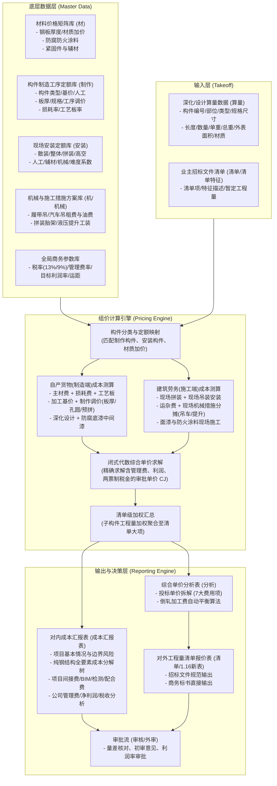
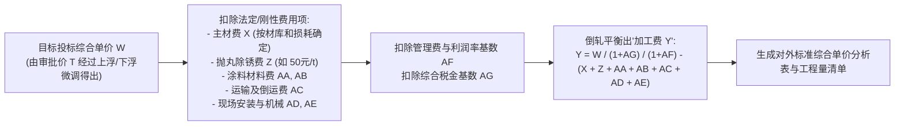

# 钢结构商务估价系统：从 Excel DIY 到标准化软件的深度业务逻辑与系统架构设计

## 一、 背景与痛点剖析：Excel DIY 模式向工业级软件演进

在大型钢结构工程（如高铁站房、机场航站楼、高层重钢、大型网架与管桁架）的商务投标与成本测算中，传统 Excel 工具普遍存在以下深层痛点：

1. **表格结构松散脆弱**：
   - 跨表引用错综复杂（如从 `算量` -> `审` -> `分析` -> `清单` / `成本汇报表`），行插入、删除极易引发 `#REF!` 引用断裂（在本表格的 `成本汇报表` 第 18~24 行即存在该问题）。
   - 大量硬编码索引：使用形如 `VLOOKUP(..., 29, FALSE)`、`VLOOKUP(..., 86, FALSE)`，一旦增减列，整个组价系统数据错位。
2. **两票制与双轨制成本核算的复杂性**：
   - 钢结构行业典型的“自产货物（工厂制造 13% 税率）+ 建筑安装劳务（现场施工 9%/3% 税率）”两票制，使得材料、制造、拼装、吊装、机械、管理费、利润的税费分摊极为复杂。
   - Excel 中为避免循环引用，往往需要复杂的代数方程或人工反复试凑。
3. **对外清单与对内成本脱节**：
   - 内部算量是按构件明细（柱、梁、撑、板厚、材质、节点）精细化核算；
   - 外部招标文件清单则是粗粒度的综合项目（如“实腹钢柱 1485t”），且各地方、各业主对清单计价项（主材、加工、除锈、油漆、运输、安装、管理费、利润、税金）的拆解规则各异，人工在 Excel 中“倒轧填平”耗时且极易算错。
4. **数据库与经验无法沉淀**：
   - 材料价格、工厂加工工时定额、现场拼装安装定额、全国各大区机械租赁价格散落在个人工作表中，无法形成企业级知识资产与动态基准库。

---

## 二、 核心业务数据流拓扑图

系统从工程量输入到对内汇报、对外报表输出的全流程拓扑如下：



---

## 三、 第一部分：三大核心数据库规范设计 (Database Schema)

在软件系统中，必须将散落在各工作表中的基础表格抽取为独立、结构化、支持版本化管理的企业级数据库。

### 1. 材料价格矩阵库 (`材` 表对象化)
钢材价格并非单一标价，而是由“基价 + 材质加价 + 规格加价 + 工艺附加”构成的多维定价模型：

* **数据实体定义**：
  * **主键**：`material_key` (如 `厚度_材质_性能`，例如 `80_Q355B`, `30_Q345GJC`, `25_Q420B`)
  * **材料类型**：钢板 (中厚板/特厚板)、热轧型钢 (H/工/角/槽)、钢管 (焊管/无缝管/高频焊管)、高强螺栓、栓钉、焊接材料 (焊丝/焊剂)
  * **价格要素拆解**：
    $$\text{不含税出厂价} = \frac{\text{我的钢铁网基价} + \text{厚度规格加价} + \text{材质加价} + \text{正火加价} + \text{Z向性能加价 (Z15/Z25/Z35)} + \text{原材运费}}{1 + \text{增值税率 (13\%)}}$$
  * **涂料价格库**：
    * 涂料品种：环氧富锌底漆、环氧云铁中间漆、聚氨酯面漆、氟碳面漆、防火涂料（超薄型/薄型/厚型，耐火极限 1.0h/1.5h/2.0h/3.0h）。
    * 定额参数：固体份含量、干膜厚度 ($\mu m$)、理论涂布率 ($m^2/kg$)、损耗系数、除税材料单价、施工费单价。

### 2. 构件制造工序定额库 (`制作` 表对象化)
涵盖构件制造车间的标准工时与直接加工成本：

* **构件部位分类**：柱墙类、梁类、桁架类、网架类、支撑类、围护类、连接节点。
* **构件名称/细分**：
  * 柱类：热轧H型、焊接H型、焊接箱型、十字柱、日字型、亚字型、格构柱等；
  * 梁类：焊接箱梁（有/无牛腿）、钢桁架梁、蜂窝梁、型钢组合梁等；
  * 网架/空间结构：焊接空心球节点、螺栓球节点、铸钢节点。
* **基础制造成本三要素**：
  * 固定成本分摊 (折旧、厂房、动力等，如基准 207 元/t)；
  * 材料与辅材机械消耗 (焊丝、二氧化碳气体、切割气、工机具等)；
  * 制造车间直接人工费。
* **制作动态调价规则矩阵 (Adjustment Rules)**：
  * **板厚加价规则**：
    $$\Delta P_{厚} = \begin{cases} 30 \text{ 元/t}, & t \le 16\text{mm} \\ 0 \text{ 元/t}, & 16 < t \le 35\text{mm} \\ 50 \text{ 元/t}, & 35 < t \le 48\text{mm} \\ 90 \text{ 元/t}, & 48 < t \le 78\text{mm} \\ 140 \text{ 元/t}, & t > 78\text{mm} \end{cases}$$
  * **特殊工序加价**：车削机加工、构件热浸镀锌、构件弯圆或数控打孔、厂内整榀预拼装、驻厂监造与第三方探伤检测费。
  * **制造损耗与工艺板**：
    * 构件材料损耗率 $R_{损耗}$（如型钢 3%，箱型/十字柱 5%~8%）；
    * 工艺板损耗率 $R_{工艺板}$（如隔板、引弧板、衬板等，按构件类型取 1%~4%）。

### 3. 现场安装定额库 (`安装` 表对象化)
针对不同建筑结构形态和施工工法的安装基价体系：

* **构件安装分类**：多高层重钢安装、空间结构安装、工业厂房轻钢、钢桥梁。
* **定额细分项目**：如 `重钢H型钢柱`、`重钢十字/异形柱`、`格构柱散装/整装`、`钢桁架散拼/整体吊装`、`焊接球网架高空散拼` 等。
* **安装成本四要素**：
  * 人工费 (拼装工、起重工、电焊工、架子工)；
  * 辅助材料费 (定位板、卡具、临时垫铁、缆风绳)；
  * 小型机具费 (焊机、空压机、扭剪扳手、烘干箱)；
  * 其他直接费。
* **工法系数与扣除项**：
  * 拼装/安装分离机制：可单独选择现场是否发生地面拼装；
  * 水电费扣除项：若业主或总包免费提供水电源，可配置扣减；
  * 吊装机械扣除项：若现场主吊机械由总包提供，可单独扣减安装基价中的机械成分。

### 4. 大型机械与施工专项方案库 (`机` & `机械` 表对象化)
钢结构工程中机械费用往往占到总成本的 10%~20%，且与吊装施工方案深度绑定：

* **机械台班基准数据库**：
  * 按全国 6 大区域（华东、华北、东北、中南、西南、西北）维护不同规格吊机（履带吊 50t~650t、汽车吊 25t~500t、塔吊 TC7527 等）的月租金基准与燃油消耗指标；
  * 进出场运输费与安拆费测算模型：
    $$\text{进出场费} = \text{单程运距 (km)} \times \text{吨公里运价系数} \times \text{设备吨位} \times 2$$
* **施工专项措施方案模型 (工装与专项方案)**：
  * 吊装胎架/支撑架：吨位、租赁/制作单价、周转倒运次数；
  * 液压整体提升专项系统：柱顶提升架、四叉/三叉支撑架、液压提升器（台次/点位）、上下锚点、临时结构加固杆件；
  * 方案总成本汇总与吨位分摊：
    $$\text{机械措施每吨单价 } (BS13) = \frac{\sum (\text{吊装机械租费} + \text{燃油费} + \text{进出场费}) + \sum \text{专项工装措施费}}{\text{项目总吨位}}$$

---

## 四、 第二部分：核心组价引擎与算法模型 (Pricing Engine)

### 1. 构件级组价映射流程
1. **输入明细读取**：从深化/设计算量结果中提取各构件记录：`{构件编号, 部位, 构件类型, 截面尺寸(H, B, tw, tf), 材质, 数量, 吨位, 表面积}`。
2. **截面与理论重量自动验算**：
   例如十字柱截面理论单重公式：
   $$W_{单} = \left[(2H - 4t_f - t_w) \times t_w + 4B \times t_f\right] \times 0.00785 \text{ kg/m}$$
3. **关联组价定额**：
   * 自动匹配制造构件类别（如十字型钢柱）；
   * 自动匹配安装构件类别（如空间十字、异形钢柱）；
   * 自动根据主板厚度 $t$ 与材质，从材料库匹配原料除税单价 $P_{原材}$。

### 2. 双轨制（两票制）成本计算模型

根据我国税务与工程结算规范，钢结构工程通常分为自产货物销售（制造厂开具 13% 专票）和建筑安装劳务（施工现场开具 9% 专票）：

#### (A) 自产货物制造部分（单价小计 1，除税价）
1. **钢材主材单价**：$P_{主材} = P_{材料库}(板厚, 材质)$
2. **材料损耗费**：$P_{损耗} = P_{主材} \times R_{损耗}$
3. **工艺板费用**：$P_{工艺板} = CJ \times R_{工艺板}$（与最终综合单价挂钩）
4. **制作费**：$P_{制作} = \text{制作基价}$
5. **制作调价**：$P_{调价} = \sum (\text{板厚加价} + \text{规格加价} + \text{螺栓栓钉} + \text{钻孔/弯圆} + \text{预拼装} + \text{驻厂监造})$
6. **深化设计费**：按吨分摊固定费率（如 50 元/t）
7. **防腐底漆与中间漆**：$P_{底漆} + P_{中漆}$（材料费 + 工厂喷涂费）
8. **制造部分增值税金**：
   $$Tax_{货} = \left(P_{主材} + P_{损耗} + P_{工艺板} + P_{制作} + P_{调价} + P_{深化} + P_{涂装}\right) \times \tau_{货} \quad (\tau_{货} = 13\%)$$

#### (B) 现场建筑劳务部分（单价小计 2，含税基价与劳务）
1. **现场拼装费**：$P_{拼装} = \text{拼装基价} \times \text{难度系数} - \text{扣减项}$
2. **现场安装费**：$P_{安装} = \text{安装基价} \times \text{难度系数} - \text{扣减项}$
3. **构件运输费**：$P_{运输} = \text{运距} \times \text{吨公里单价}$
4. **大型机械措施费**：$P_{机械} = BS13$（由机械方案测算分摊所得）
5. **现场面漆与防火涂料施工费**：$P_{面漆} + P_{防火}$
6. **现场管理费**：$P_{管理} = CJ \times R_{管理费率}$
7. **投标目标利润**：$P_{利润} = CJ \times R_{利润率}$
8. **建筑劳务增值税金**：
   $$Tax_{建} = \left(P_{拼装} + P_{安装} + P_{运输} + P_{机械} + P_{涂装施工} + P_{管理} + P_{利润}\right) \times \tau_{建} \quad (\tau_{建} = 9\%)$$

---

### 3. 闭式解代数无死循环求解模型 (Closed-Form Analytical Solution)

在传统 Excel 中，由于管理费 $P_{管理}$、利润 $P_{利润}$、工艺板费 $P_{工艺板}$ 都直接以**最终综合单价 $CJ$** 为基数进行百分比提成，导致公式出现循环引用。本表格在第 88 列 (`CJ` 列) 运用了精妙的代数恒等式直接求解，软件系统的后端算法必须直接继承该闭式数学模型：

设：
* $C_1 = P_{主材} + P_{损耗} + P_{制作} + P_{调价} + P_{深化} + P_{底漆} + P_{中漆}$（制造端固定成本项）
* $C_2 = P_{拼装} + P_{安装} + P_{运输} + P_{机械措施} + P_{面漆施工} + P_{防火涂料施工}$（施工端固定成本项）
* $\tau_1 = \tau_{货} = 13\%$，$\tau_2 = \tau_{建} = 9\%$
* $r_{工艺} = R_{工艺板}$，$r_{管} = R_{管理费率}$，$r_{利} = R_{利润率}$

则含税综合单价方程为：
$$CJ = \left[ C_1 + r_{工艺} \cdot CJ \right] \times (1 + \tau_1) + \left[ C_2 + (r_{管} + r_{利}) \cdot CJ \right] \times (1 + \tau_2)$$

展开提取公因式 $CJ$：
$$CJ - r_{工艺} (1 + \tau_1) \cdot CJ - (r_{管} + r_{利}) (1 + \tau_2) \cdot CJ = C_1 (1 + \tau_1) + C_2 (1 + \tau_2)$$

$$CJ \left[ 1 - r_{工艺} (1 + \tau_1) - (r_{管} + r_{利}) (1 + \tau_2) \right] = C_1 (1 + \tau_1) + C_2 (1 + \tau_2)$$

最终得到**综合单价精确闭式解**：
$$CJ = \frac{C_1 (1 + \tau_1) + C_2 (1 + \tau_2)}{1 - r_{工艺} (1 + \tau_1) - (r_{管} + r_{利}) (1 + \tau_2)}$$

> [!TIP]
> 软件实现时，只需计算分子（两部分不含可变比例的含税成本之和）与分母（1 减去所有可变费率含税占比），一步完成 O(1) 复杂度的瞬时计算，彻底消除迭代逼近与循环引用！

---

## 五、 第三部分：报表体系与对外清单逆算平衡机制 (Reporting Engine)

### 1. 对内成本核算体系：项目全要素成本汇报表 (`成本汇报表`)

对内报表服务于企业经营层、成本控制中心与决策委员会，用于核定底线成本与投标报价策略：

1. **项目边界与商务风险卡片**：
   - 招标方式、承包结算模式（固定单价/总价包干）；
   - 材料调差约定（调差基准日、风险幅度范围如 $\pm 5\%$ 风险共担）；
   - 付款条件与现金流预测（预付款比例、进度款节点、质保金返还时间与贴息成本）。
2. **纯钢结构工程成本树 (Cost Breakdown Structure)**：
   - 材料费小计（各厚度规格板材、型钢、加价与损耗合计）；
   - 加工制作费（厂内人工、固定折旧、辅耗材、螺栓栓钉、预拼装等）；
   - 防腐防火工程（底漆、中间漆、面漆材料与施工）；
   - 运输与物流（原材运费、倒运、成品出厂运费）；
   - 现场安装与拼装（拼装工装、高空安装人工与辅材）；
   - 专项施工措施（大型吊机台班、整体液压提升、临时支撑胎架、安全通道）。
3. **间接费与项目包干管理费**：
   - 安全文明施工费、工程一切险与第三者责任险；
   - 深化图纸设计与审核费、第三方无损探伤检测费；
   - 精工 BIM 管理平台服务费（定额分摊，如 22 元/t）；
   - 总包管理配合费、现场临时设施费。
4. **两票制企业税费与净利润**：
   - 制造税金 (13%)、安装税金 (9%/3%)、公司管理费、净收益率测算。

---

### 2. 对外清单生成与“倒轧平衡算法” (`分析` 与 `清单` 表)

对外清单报价是整个商务流程中最具“行业特色”的难点。招标文件给出的清单通常只有粗粒度的一行（如“实腹钢柱 1485t”），但开标时必须同时提供详细的《综合单价分析表》，包含主材、加工、除锈、油漆、运杂、安装、机械、管理利润、税金 9 项明细，且要求**9项之和必须分毫不差等于最终投标综合单价**。

在表格中，实操人员使用的是“倒轧平衡法”，软件系统应将其固化为标准算法模块：



* **倒轧加工费公式**：
  $$P_{加工} = \frac{W}{(1 + R_{税}) (1 + R_{管利})} - \left(P_{主材} + P_{除锈} + P_{底漆} + P_{中漆} + P_{运输} + P_{安装} + P_{机械}\right)$$
* **效果**：
  无论最终报价如何微调上浮或下浮，主材、油漆、安装等刚性成本均真实体现，所有调价幅度被自动吸收进入制造加工费中，使对外的分项明细合价严密契合招标软件的校验规则。

---

## 六、 第四部分：软件系统架构与产品化落地规划

### 1. 系统模块划分

```
├── 1. 基础数据库中心 (Master Data Hub)
│   ├── 原材与加价行情库 (集成网络行情爬虫与手工录入)
│   ├── 构件制造工序定额库 (标准工时、板厚调价矩阵)
│   ├── 施工安装与拼装定额库 (按结构类型分级)
│   └── 机械设备台班与专项工装方案库 (全国大区价格)
│
├── 2. 算量导入与智能映射引擎 (Takeoff & Mapping Engine)
│   ├── Excel / 3D Tekla / BIM 模型算量清单一键导入
│   ├── 构件截面特征智能识别 (H型、箱型、十字、圆管等自动分类)
│   └── 定额规则自动推荐与批量匹配
│
├── 3. 商务组价工作台 (Commercial Pricing Workbench)
│   ├── 双轨制组价核心计算器 (闭式代数公式，实时毫秒级响应)
│   ├── 方案级机械措施协同 (吊装方案直接关联构件分摊)
│   └── 不平衡报价与调价沙盘 (支持按清单项设置上浮/下浮比率)
│
├── 4. 报表与标书生成器 (Reporting & Exporting)
│   ├── 业主格式清单匹配器 (智能映射至招标清单编码)
│   ├── 综合单价逆算平衡引擎 (自动生成合规 9 费项拆解表)
│   ├── 内部多维度成本汇报表 (管理层审批看板、打印与导出)
│   └── 历史标底对比与量差敏感度分析
│
└── 5. 权限与审批流中心 (Workflow & Versioning)
    ├── 编制人、专业审核人、分管领导多级审批
    └── 版本快照管理 (记录每一次调价历史与理由)
```

### 2. 核心数据表 E-R 概念模型建议

* `Project` (项目基础信息表：名称、标段、业态、区域、税率模式、投标截止期)
* `SteelMaterial` (钢板/型钢基准行情与加价规则表)
* `FabricationNorm` (加工定额基价与板厚调价规则表)
* `InstallationNorm` (安装定额基价与现场工况参数表)
* `MachineryScheme` (项目机械方案与专项工装费用明细表)
* `TakeoffItem` (算量构件明细表：尺寸、重量、外表面积、材质)
* `PricingItem` (组价计算明细表：关联算量项，存储制造端、安装端分项成本及闭式求解单价)
* `BillOfQuantity` (对外清单项表：清单编码、名称、特征、暂定工程量、最终报价、倒轧分项明细)

---

## 七、 总结

通过对《1.29湛江北站审批表-孙烽.xlsx》的深度解构，我们还原出了大型钢结构龙头企业（精工钢构体系）历经多年沉淀的核心估价知识与商务精髓：
1. **底层三库**（材料价格库、制造定额库、安装定额库）构成了组价的基石；
2. **两票制与闭式解代数引擎**解决了制造与安装跨税率、可变利润率循环引用的计算核心；
3. **倒轧加工费平衡机制**打通了内部真实成本向对外合规清单的灵活转换。

将这套逻辑沉淀为现代化软件工具，将彻底终结“每个人各有一张易错 DIY Excel”的混乱局面，实现企业级商务估价的标准化、敏捷化与资产化。
