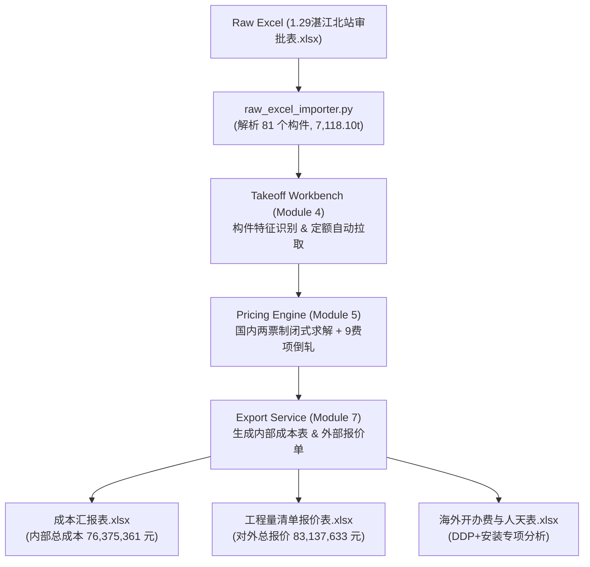

# 004 Plan: 全量数据导入、业务服务层完善、Excel报表导出与全案对账计划

> **版本**：1.0.0  
> **状态**：执行中 (In Progress)  
> **基准工程**：湛江北站特大型高铁站房钢结构工程（7,118.10 t / 8,313.76 万元）

---

## 1. 任务背景与目标

在前期完成核心闭式代数求解器、海外人天开办费引擎、9费项倒轧平衡算法、数据库实体模型以及 HIS 风格三栏式/灵活明细算量工作台原型后，本阶段将继续执行并彻底打通**端到端全量数据闭环**：

1. **原始数据全量吞吐 (`raw_excel_importer.py`)**：从原始 Excel `审` 工作表完整抽取全部 10 大清单项、81 项具体构件明细，校验自算量 7,118.10 t 与清单量 7,945.00 t；
2. **后端服务层完整构建 (`src/services/`)**：
   - `project_service.py`：项目生命周期管理、国内外业务模式互斥切换、版本基线树派生（V1.0底线成本版 -> V1.1首次投标报价版 -> V1.2二次澄清调价版）；
   - `quota_service.py`：解耦微工序定额库管理、快照冻结与派生（制作7道工序、安装6道工序、海外人天标准）；
   - `approval_service.py`：审批流程状态机与基线行级锁定机制；
3. **成果报表双轨生成 (`export_service.py`)**：
   - 自动生成符合企业内部规范的《对内成本汇报表》（`cost_reports/`）；
   - 自动生成符合国标与铁路规范的《工程量清单报价表》（`bid_quotes/`，含税 83,137,633.41 元）；
   - 自动生成符合海外工程规范的《海外人天与现场开办费清单》（`overseas_docs/`）；
4. **Git Worktree 隔离机制实操验证**：在 `worktrees/` 目录下实装特性分支副本，验证 Git 版本忽略与多版本并行隔离；
5. **全流程回归对账与审计测试**：编写全量回归测试套件，验证 81 项构件、7,118.10 吨位、76,375,361 元内部成本、83,137,633 元对外报价全部零误差闭合。

---

## 2. 详细执行路线 (Implementation Roadmap)

---

## 3. 产出清单与验收标准

| 序号 | 交付物 | 路径 | 核心指标 / 验收标准 |
| :--- | :--- | :--- | :--- |
| 1 | 全量数据抽取器 | `src/services/raw_excel_importer.py` | 81 个构件完全解析，钢构总吨位 = 7,118.0958 t，清单总量 = 7,945.00 t |
| 2 | 项目与版本服务 | `src/services/project_service.py` | 支持国内/海外模式切换、V1.0/V1.1/V1.2 基线树派生与锁定 |
| 3 | 定额微工序服务 | `src/services/quota_service.py` | 制作7道微工序、安装6道微工序细粒度解耦与热重算支撑 |
| 4 | 审批流控制服务 | `src/services/approval_service.py` | 待审、已审、已驳回、已封存四级状态流转与不可逆加锁 |
| 5 | Excel 报表导出器 | `src/services/export_service.py` | 生成对内成本表、对外清单报价表、海外开办费单据 |
| 6 | 全案集成测试用例 | `tests/regression/test_full_pipeline_reconciliation.py` | 76,375,361.03 元内部成本与 83,137,633.41 元报价 100% 闭合 |
| 7 | Worktree 验证 | `worktrees/v1.2-overseas-feat` | 分支独立运行且根目录 `git status` 洁净不受污染 |
| 8 | 执行记录报告 | `docs/changelogs/005_walkthrough_full_pipeline_and_reports.md` | 完整记录执行数据、对账明细与代码路径 |
