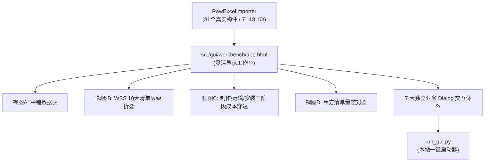

# 006 Plan: 全量 81 构件交互式 GUI 工作台、分模块 Dialog 集成与本地运行器计划

> **序列号**：006  
> **制定时间**：2026-11-19  
> **状态**：执行中 (IN PROGRESS)  
> **基准工程**：湛江北站高铁站房钢结构工程（81 项构件，7,118.10 t / 8,313.76 万元）

---

## 1. 任务背景与目标

前五轮迭代已完全打通底层代数闭式求解器、海外人天与开办费引擎、9 费项倒轧平衡算法、全量 81 构件数据抽取以及 Excel 双轨报表导出。

本阶段重点执行前序 Plan 中**尚未落地的展现层与交互运行层**：
1. **真实数据驱动的 GUI 算量工作台 (`src/gui/workbench/`)**：
   - 将抽取出的 **湛江北站全部 81 项真实构件**（78 钢结构 + 3 螺栓紧固件）完整注入工作台；
   - 落地 **4 大灵活显示视图**：平铺工作表 (Flat Grid)、WBS 空间层级折叠 (Tree Grid)、三阶段成本穿透 (3-Phase Cost Penetration)、甲方清单量差对照 (BQ Alignment)；
   - 实现**动态列定制抽屉**、**截面族/材质多维快速筛选**与**特厚板 ($\ge 80\text{mm}$) / 异常未匹配智能高亮告警**；
2. **完整独立 Dialog 交互组件体系 (`src/gui/dialogs/`)**：
   - `ProjectDialog`：国内 4 模式 / 境外 6 模式互斥切换、版本基线树展示；
   - `QuotaNormDialog`：制作 7 道微工序、安装 6 道微工序细粒度定额查看与微调；
   - `TakeoffDialog`：手工键盘录入与几何板厚推导、定额自动拉取检查器；
   - `PricingDialog`：国内两票制闭式解析单价透视与境外人天开办费测算；
   - `BQMappingDialog`：9 费项倒轧平衡实时计算与安全边际预警；
   - `ApprovalDialog`：四级审签流程流转与基线锁定；
   - `ReportDialog`：对内成本表、对外报价表、海外开办费单据一键导出；
3. **本地 GUI 桌面/Web 运行器 (`src/gui/run_gui.py`)**：
   - 提供开箱即用的本地服务启动器，一键拉起浏览器访问完整交互式工作台；
4. **轻量 API 服务路由 (`src/api/`)**：
   - 暴露 `/api/v1/takeoff`、`/api/v1/projects`、`/api/v1/quotas` 等 REST 数据接口，方便后续集成 Google Stitch 生成的前端组件与前后端分离部署。

---

## 2. 详细执行路线 (Implementation Roadmap)

---

## 3. 产出清单与验收标准

| 序号 | 交付物 | 路径 | 核心指标 / 验收标准 |
| :--- | :--- | :--- | :--- |
| 1 | 81 构件灵活工作台 | `src/gui/workbench/app.html` | 81 个真实构件全部渲染，支持平铺、WBS层级、成本穿透、清单对照4视图流畅切换 |
| 2 | 独立业务 Dialog 模态层 | `src/gui/workbench/dialogs.js` | 覆盖项目、定额、算量、组价、倒轧、审批、报表 7 大业务弹窗 |
| 3 | 本地 GUI 运行器 | `src/gui/run_gui.py` | 支持 `uv run python -m src.gui.run_gui`，自动唤起浏览器并承载工作台 |
| 4 | API 路由服务 | `src/api/v1/api_router.py` | 提供 JSON 接口输出项目、构件与定额数据 |
| 5 | 测试套件 | `tests/unit/test_gui_and_api.py` | 验证 GUI 数据文件完整性与 API 序列化无异常 |
| 6 | 演练记录报告 | `docs/changelogs/007_walkthrough_gui_runner_and_api_verification.md` | 完整记录执行数据与截图/验证步骤 |
