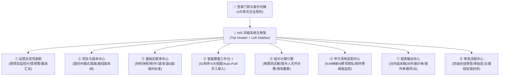

# 008 Plan: 全生命周期 HIS 估价中台落地计划（系统登录、8大业务模块全景工作区与角色协同）

> **序列号**：008  
> **制定时间**：2026-11-19  
> **状态**：执行中 (IN PROGRESS)  
> **基准工程**：新建广州至湛江高速铁路站房钢结构工程（7,118.10 t / 8,313.76 万元）

---

## 1. 背景与目标 (Background & Objectives)

在前序阶段中，系统已完成了底层数学闭式求解器、海外人天与开办费引擎、9 费项倒轧平衡算法、全量 81 个湛江北站真实构件抽取以及算量工作台表格的原型搭建。

然而，此前系统界面主要局限在单个算量表格计算界面。根据 `docs/gui_specs/gui_module_design.md` 以及 `docs/architecture/multi_tier_steel_architecture.md` 的总体策划，系统应具备完整的**全生命周期中台架构**，涵盖从“一开始的登录与角色身份切换”到“全流程八大业务模块全景工作区”的完整落地。

本 Plan 旨在将上述全部策划完整执行落地，实现：
1. **企业级登录门禁与 4 大角色协同体系**：
   - 登录页面与快速角色身份切换（孙烽·商务主任工程师、张君·专业审核人、李明·商务总监、王振华·分管副总）；
   - 顶部全局状态栏实时展示当前用户身份、所属角色、项目基准指标与随时退出/切换身份功能；
2. **HIS 风格八大独立功能工作台全景落地**：
   - **① 运营总览驾驶舱** (`MODULE 1`)：在途项目健康度、4 大重点项目卡片、钢材行情异动大屏预警、特厚板跨项目集采汇总；
   - **② 项目与版本中心** (`MODULE 2`)：立项、国内 4 模式 / 境外 6 模式互斥切换、动态参数配置、不可篡改基线版本树可视化；
   - **③ 基础定额库中心** (`MODULE 3`)：材料价格快照、制作 7 道微工序、安装 6 道微工序、海外标准费率包 (吃住行/PPE/开办费)、机械台班库；
   - **④ 智能算量工作台 ⭐** (`MODULE 4`)：81 个真实构件全量数据、4 大灵活视图（平铺、WBS清单层级折叠、三阶段成本穿透、甲方清单量差对照）、Auto-Pull 定额自动拉取检查器、手工快速录入构件行；
   - **⑤ 组价计算引擎** (`MODULE 5`)：国内两票制闭式代数公式全景计算器与参数滑块、境外人天成本法与现场开办费实时测算；
   - **⑥ 甲方清单适配中心** (`MODULE 6`)：铁路清单/国标/FIDIC 模板联动、N:M 构件绑定映射区、9 费项倒轧平衡算法动态测算与安全边际阈值监测（$\ge 600\text{元/t}$）；
   - **⑦ 报表输出中心** (`MODULE 7`)：对内成本汇报表、材料敏感度报告、版本对比表；对外清单报价表、9 费项综合单价分析表；境外 FIDIC 单据（装箱清单、商业发票、开办费明细、派驻工日测算）；支持在线预览、Excel/PDF/JSON 导出；
   - **⑧ 审批流程中心** (`MODULE 8`)：4 级在线审签流转图、审签批注记录流、在线审签操作 (批准/退回)、不可逆加锁封存基线；
3. **保留并增强 Dialog 快捷浮层与本地 GUI 运行器**：
   - 支持桌面本地一键运行 (`uv run python -m src.gui.run_gui`)；
   - 保证全套回归测试与 xUnit 规则巡检 100% 通过，数据零漂移。

---

## 2. 实施架构图 (System Architecture)

---

## 3. 交付清单与验收标准

| 序号 | 交付物 | 文件路径 | 验收标准 |
| :--- | :--- | :--- | :--- |
| 1 | 全景 HIS 工作台与登录系统 | `src/gui/workbench/app.html` | 包含登录门禁、角色切换、8 大业务工作区、4 大视图与完整数据联动 |
| 2 | 本地 GUI 运行器验证 | `src/gui/run_gui.py` | 正常监听并可随时拉起浏览器体验全生命周期系统 |
| 3 | 单元与回归测试套件 | `tests/unit/test_gui_and_api.py` 等 | 13 项 pytest 单元与回归测试 100% 通过 |
| 4 | xUnit 规则巡检 | `src/utils/xunit_inspector.py` | 12 项合规巡检项 100% 通过，生成 XML 报告 |
| 5 | 演练记录报告 | `docs/changelogs/009_walkthrough_full_system_lifecycle_execution.md` | 记录演练详情、截图/交互流程说明与验证结论 |
