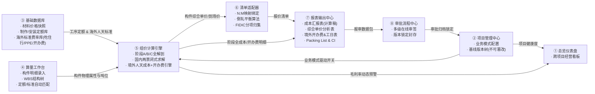

# 钢结构商务估价系统 · GUI 模块化产品设计规范

> 参照医院信息系统（HIS）的模块化分区设计思路，将复杂的商务估价业务拆分为职责单一、高内聚低耦合的功能模块，每个模块对应明确的业务角色与操作场景。

---

## 一、 业务模式分类纠正：国内 vs 境外严格分离

> [!IMPORTANT]
> **国内两票制 ≠ DAP/DDP**。两票制是中国税务层面的发票拆分机制（制造 13% + 安装 9%），与 Incoterms 国际贸易术语是完全独立的两套体系。系统必须在项目立项时明确区分业务模式，避免错误套用。

### 国内业务：按承包范围分为 4 种模式

```
国内钢结构业务模式
│
├── 模式1：纯制作供货（散件出厂）
│   范围：原材采购 → 车间制作 → 防腐涂装 → 出厂
│   结算：仅开具增值税专票 13%（货物销售）
│   典型场景：总包自行运输安装；业主甲供钢构；贸易型合同
│
├── 模式2：制作 + 运输到场（供货到现场）
│   范围：制作 + 长途干线运输 + 现场卸货倒运
│   结算：制作与运输同开 13% 货物专票（制造厂代开）
│   典型场景：业主/总包指定安装单位，乙方只负责送货上门
│
├── 模式3：制作 + 安装（两票制，不含运输独立分包）
│   范围：制作 + 现场安装（运费含在制作票内）
│   结算：制作票 13% + 安装票 9%（建筑安装劳务）
│   典型场景：钢结构专业分包（最常见的国内商业模式）
│
└── 模式4：制作 + 运输 + 安装（EPC 全包，两票制）
    范围：全链条承包，制作、运输、现场安装全部自营
    结算：制作票 13% + 安装票 9%（运费含在制造票内）
    典型场景：大型钢结构 EPC 总承包；高铁站房钢结构工程
```

### 境外/出口业务：按 Incoterms + 安装范围分为 6 个模式

```
境外/出口业务（Incoterms 2020 + 安装选项）
│
├── EXW（工厂交货）
│   价格边界：工厂大门，买方承担此后所有风险与费用
│
├── FOB（离岸价）
│   价格边界：在出口港将货物装上船
│   = EXW + 国内运输 + 港口操作 + 出口清关
│
├── CFR / CIF（到港成本 / 加保险）
│   价格边界：货物到达目的港
│   = FOB + 国际海运 (+ 海运保险)
│
├── DAP（目的地交货）
│   价格边界：在目的国指定地点交货（不含进口税）
│   = CFR + 目的港卸货 + 目的地内陆短驳
│
├── DDP（完税后交货，不含安装）
│   价格边界：完成进口清关、缴纳关税后在目的地交货
│   = DAP + 进口关税 + 进口增值税 + 报关费
│   典型场景：买方自有安装团队，只需乙方供货到场
│
└── DDP + 现场安装（境外 EPC 全包，含安装）⭐ 新增
    价格边界：完成进口清关 + 完成现场安装就位
    = DDP + 阶段C境外安装（人天制成本法）+ 开办费
    ⚠️ 关键区别：境外安装成本 ≠ 国内安装定额
       · 国内安装：套用企业制造定额（元/t 固定基价）
       · 境外安装：按"人员派驻人天成本法"计算（无定额可套）
       典型场景：东南亚/非洲/中东钢结构 EPC 总承包
```

---

## 二、 系统 GUI 总体布局（参照 HIS 分区设计）

医院 HIS 系统的精髓是：**左侧导航模块分区 + 顶部状态栏 + 主内容工作区 + 右侧辅助面板**。钢结构商务系统完全沿用这一经过医疗行业检验的 UI 范式：

```
┌─────────────────────────────────────────────────────────────────────────────┐
│  🔷 SteelBid Pro                    [项目: 湛江北站 V1.1]  [用户: 孙烽·商务工程师]  │  ← 顶部状态栏
├──────────┬──────────────────────────────────────────────┬───────────────────┤
│          │                                              │                   │
│  导航    │            主工作区 (Main Canvas)             │   辅助面板         │
│  模块    │                                              │   (Context Panel) │
│  区      │  根据左侧选中模块动态渲染对应功能界面            │                   │
│          │                                              │  · 快捷数据引用     │
│  ① 总览  │                                              │  · 材料行情看板     │
│  ② 项目  │                                              │  · 计算过程展开     │
│  ③ 数据库│                                              │  · 审批意见流       │
│  ④ 算量  │                                              │  · 历史版本对比     │
│  ⑤ 组价  │                                              │                   │
│  ⑥ 清单  │                                              │                   │
│  ⑦ 报表  │                                              │                   │
│  ⑧ 审批  │                                              │                   │
│  ⚙ 系统  │                                              │                   │
│          │                                              │                   │
├──────────┴──────────────────────────────────────────────┴───────────────────┤
│  状态栏: 当前材料快照 [MAT-2026-Q1]  定额版本 [NORM-2026-V1]  计算耗时 0.08s      │
└─────────────────────────────────────────────────────────────────────────────┘
```

---

## 三、 八大功能模块详细设计

### MODULE 1 · 总览仪表盘（类比 HIS: 院长驾驶舱）

**定位**：管理层和商务总监的全局视角，一屏掌握所有在途项目的商务健康状态。

```
┌─────────────────────────── 项目总览仪表盘 ───────────────────────────────────┐
│                                                                              │
│  ┌── 在途项目快照 ──────────────────────────────────────────────────────┐   │
│  │  🔵 投标中 (4)   🟡 中标谈判 (2)   🟢 执行中 (8)   ⚪ 历史归档 (127)   │   │
│  └──────────────────────────────────────────────────────────────────────┘   │
│                                                                              │
│  ┌── 项目卡片列表 ─────────────────────────────────────────────────────┐    │
│  │  [湛江北站]  国内·EPC全包  7,118t  利润率:-7.15%  ⚠ 材料待确认      │    │
│  │  [白云机场]  国内·EPC全包  12,000t 利润率:+3.2%   ✅ 已封存V2.0     │    │
│  │  [雅加达机场] 境外·FOB    5,200t  利润率:+8.5%   🔄 编制中         │    │
│  │  [沙特炼厂]  境外·DAP     3,800t  利润率:+12%    📋 待审批          │    │
│  └──────────────────────────────────────────────────────────────────────┘   │
│                                                                              │
│  ┌── 本周材料行情预警 ──┐  ┌── 跨项目集采汇总 ──────────┐                   │
│  │  Q355B 80mm  ↑ 3.2%  │  │  特厚板(≥60mm): 合计2,840t  │                   │
│  │  Q420GJC    ↑ 1.8%   │  │  高性能建筑钢:  合计  450t  │                   │
│  │  H型钢      ↓ 0.5%   │  │  → [发起集中采购谈判]       │                   │
│  └──────────────────────┘  └────────────────────────────┘                   │
└──────────────────────────────────────────────────────────────────────────────┘
```

**核心功能**：
- 多项目健康度指数（利润率、量差率、版本状态）
- 钢材行情异动预警（与项目绑定的价格快照对比，自动标红）
- 跨项目特殊规格材料集采需求自动汇总
- 一键进入任意项目的工作台

---

### MODULE 2 · 项目管理中心（类比 HIS: 患者档案管理）

**定位**：单一项目的全生命周期管理，包括立项、版本控制、业务模式配置。

```
┌──────────────────── 项目管理中心 ─────────────────────────────────────────┐
│                                                                            │
│  [新建项目]  [克隆项目]  [导入招标文件]                                     │
│                                                                            │
│  ┌── 项目基本信息 ─────────────────────────────────────────────────┐      │
│  │  项目名称:  广州至湛江高速铁路站房钢结构工程                        │      │
│  │  业主单位:  中国铁路广州局集团有限公司                             │      │
│  │  建筑业态:  高铁站房  [下拉选择: 高铁/机场/超高层/工业厂房/其他]    │      │
│  └────────────────────────────────────────────────────────────────┘      │
│                                                                            │
│  ┌── 承包范围与业务模式 ─────────────────────────────────────────────┐    │
│  │                                                                   │    │
│  │  ○ 国内业务                      ○ 境外/出口业务                   │    │
│  │  ┌────────────────────────────┐  ┌────────────────────────────┐  │    │
│  │  │ ◉ 纯制作供货               │  │ ○ EXW (工厂交货)            │  │    │
│  │  │ ○ 制作 + 运输到场          │  │ ○ FOB (离岸价)              │  │    │
│  │  │ ○ 制作 + 安装 (两票制)     │  │ ○ CFR / CIF                │  │    │
│  │  │ ◉ 制作+运输+安装 (EPC全包) │  │ ○ DAP (目的地交货)          │  │    │
│  │  │                            │  │ ○ DDP (完税后交货)          │  │    │
│  │  └────────────────────────────┘  └────────────────────────────┘  │    │
│  │                                                                   │    │
│  │  [选中后自动展开对应的参数配置区域]                                 │    │
│  │  > 国内-EPC全包参数: 运距 850km, 两票制税率 13%+9%                 │    │
│  └───────────────────────────────────────────────────────────────────┘    │
│                                                                            │
│  ┌── 基线版本树 (Version Tree) ─────────────────────────────────────┐     │
│  │  📁 湛江北站                                                      │     │
│  │  ├── 🔒 V1.0  内部底线成本版  [2026-01-10]  总价: 8,120万  (已封存)│     │
│  │  ├── 🔒 V1.1  商务竞标版     [2026-01-15]  总价: 7,638万  (已递标)│     │
│  │  ├── 📝 V1.2  二次澄清版     [2026-01-29]  总价: 7,638万  (当前)  │     │
│  │  └── [+ 派生新版本]                                               │     │
│  └────────────────────────────────────────────────────────────────────┘    │
└────────────────────────────────────────────────────────────────────────────┘
```

**核心功能**：
- 国内 / 境外业务模式严格分区选择（互斥，不混用）
- 国内模式下：四种承包范围配置，驱动成本引擎的科目启停
- 境外模式下：Incoterms 节点选择 + 目的国 + 海运航线 + 关税税率配置
- 版本快照树：每个版本不可篡改（只读），新修改必须派生新分支

---

### MODULE 3 · 基础数据库中心（类比 HIS: 药品库 & 检验项目库）

**定位**：整个系统的"数据心脏"，所有成本计算的基准数据均从此处获取。分为**动态数据（材料价格）**和**稳定数据（工序定额）**两大库。

```
┌──────────────────── 基础数据库中心 ───────────────────────────────────────┐
│                                                                           │
│  [材料价格库]  [制作定额库]  [国内安装定额]  [海外标准费率库⭐]  [机械库]  [费率库]│
│                                                                           │
│  ── 材料价格库（动态，支持版本快照）────────────────────────────────────   │
│                                                                           │
│  当前活跃快照: [MAT-2026-01-15]  ▼  [+ 新建快照]  [发布为活跃版本]         │
│  ┌─────────────────────────────────────────────────────────────────┐     │
│  │  厚度(mm)  材质     网价(元/t)  材质加价  正火加价  出厂除税价     │     │
│  │  6         Q235B    4,460      0         0         3,948         │     │
│  │  10        Q355B    4,500      0         0         3,982         │     │
│  │  16        Q355B    4,300      0         0         3,938         │     │
│  │  80        Q355B    4,880      150       0         4,982   ⚠↑    │     │
│  │  80        Q345GJC  4,880      150       150       5,247         │     │
│  │  [+ 添加规格]                                                    │     │
│  └──────────────────────────────────────────────────────────────────┘     │
│                                                                           │
│  ── 海外市场标准费率库（开办费与驻外成本标准 · 新兴市场人天法基准）⭐ ───   │
│                                                                           │
│  当前标准版本: [OVERSEAS-STD-2026-V1]  适用国家类别: [Tier 2 中东/拉美] ▼   │
│  ┌── 1. 每日吃住行与津贴标准 (按人天核算, 元/人/天) ───────────────┐     │
│  │  费用项           Tier1(东南亚)  Tier2(中东/拉美)  Tier3(欧美)  Tier4(非洲艰苦)│
│  │  境外伙食补助      120           180              300          220       │
│  │  现场住宿/租房     150           260              500          200       │
│  │  市内交通/通勤车   50            80               150          100       │
│  │  驻外艰苦/外派津贴 100           180              260          300       │
│  │  每日人天小计      420           700              1,210        820       │
│  └─────────────────────────────────────────────────────────────────┘     │
│  ┌── 2. 劳保用品 (PPE) 与现场防护标准包 (元/人/套，按工期摊销) ─────┐     │
│  │  标配安全包: 钢头防砸防刺鞋(180) + 国标安全帽(60) + 反光背心(25)        │
│  │  高空防护包: 五点式双大钩防坠缓冲安全带(280) + 防坠器(350)              │
│  │  特殊环境包: 防暑急救药箱/降温背心/防尘护目镜/耐油电焊手套(200)         │
│  │  单人 PPE 标准套餐合计: 1,095 元/人 (按平均派驻 180 天摊销 = 6.08元/天) │
│  └─────────────────────────────────────────────────────────────────┘     │
│  ┌── 3. 国际差旅与派驻准入基准 (按人次核算, 元/人次) ───────────────┐     │
│  │  往返国际机票: 7,500 元/人次 (含中转行李加运)                          │
│  │  工作签证/体检/居留许可: 3,200 元/人次                                 │
│  │  海外人身意外与 SOS 国际紧急救援险: 600 元/人/月                       │
│  └─────────────────────────────────────────────────────────────────┘     │
│  ┌── 4. 现场临时设施与开办费包 (Site Preliminaries, 元/月) ─────────┐     │
│  │  营地办公/集装箱房租赁: 25,000 元/月   临时发电机与柴油动力: 18,000元/月│
│  │  临时堆场与装卸场地租金: 15,000 元/月  属地合规/法律/安全认证: 50,000(一次)│
│  └─────────────────────────────────────────────────────────────────┘     │
│                                                                           │
│  ── 制作定额库（企业级锁定，国内/出口通用） ────────────────────────────   │
│  ── 国内安装定额库（按元/t固定基价，仅限境内工程）───────────────────────   │
│  ── 机械费率库（国内大区台班费率 & 境外属地吊车租赁基准）────────────────   │
│  ── 费率参数库（管理费率/利润率/境内两票制税率/境外清关税率）────────────   │
└───────────────────────────────────────────────────────────────────────────┘
```

**核心设计**：
- **材料价格库**：支持多版本快照（每次发布均有时间戳与唯一 ID），旧快照只读，新快照在草稿区编辑；
- **海外市场标准费率库**：针对新兴国际市场无固定定额可套的痛点，建立**企业级国家/地区分级标准**，固化吃住行、劳保用品（PPE）、往返差旅、现场开办费的基准价格，彻底替代盲目手算；
- **制作/国内安装定额库**：企业级权限锁定（只有技术委员会角色可编辑），普通商务工程师只读引用；
- **机械费率库**：国内按 6 大区域建立吊机台班矩阵；境外支持属地化租金行情与跨境设备海运分摊两种模式。

---

### MODULE 4 · 算量工作台（类比 HIS: 检验申请 & 医嘱录入）⭐【系统最核心环节】

**定位**：**整个商务估价系统的核心基石与日常最高频操作台**。
工程量支持高效率**手工直接输入**（或批量导入 Excel/Tekla 深化清单），工程师录入截面参数与工程量后，系统**自动去底层定额数据库中拉取各项工序定额、材料基准价及施工措施数据**，实现"手工录入几何量 → 算法秒级拉取全套定额数据"的智能协同。

```
┌──────────────────── 算量工作台 (Takeoff Workbench) ───────────────────────┐
│                                                                           │
│  当前项目: 湛江北站  基线: V1.2   [+ 手工逐项录入⭐]  [批量导入Excel] [Tekla对接]│
│                                                                           │
│  ┌── WBS 树形结构 ──┐  ┌── 构件明细工作台 (手工输入 / 实时定额拉取) ───┐  │
│  │                  │  │                                              │  │
│  │ ▼ 湛江北站       │  │  [+ 新增构件行]  [复制行]  [删除行]            │  │
│  │  ▼ A区-下部框架  │  │  编号   构件名称   截面规格       材质   件数 吨位  │  │
│  │    ◉ 钢柱系统    │  │  KZ-1  十字钢柱   1300*600*80*80 Q355B   24  250.1 │  │
│  │    ○ 钢梁系统    │  │  KZ-2  箱型钢柱   800*800*40*40  Q355B   18  180.4 │  │
│  │  ▶ B区-屋盖网架  │  │  KZ-3  圆管钢柱   P650*20        Q345GJ   8   86.9 │  │
│  │  ▶ C区-天窗结构  │  │  ...                                         │  │
│  │                  │  │  (支持手工光标直接编辑规格、件数、单件几何参数)│  │
│  └──────────────────┘  └──────────────────────────────────────────────┘  │
│                                                                           │
│  ┌── 核心联动：手工输入后系统自动拉取定额明细 (Auto-Pull Norm Details) ──┐  │
│  │  当前选中构件: KZ-1 十字钢柱 (1300×600×80×80, 250.08t)                │  │
│  │  ├── 1. 几何解析: 十字型组合柱 | 最大板厚: 80mm | 展开比: 24.5 m²/t    │  │
│  │  ├── 2. 自动拉取【材料库】: 80_Q355B 快照出厂除税价: 4,982.30 元/t     │  │
│  │  ├── 3. 自动拉取【车间制作定额库】(细粒度工序子项):                    │  │
│  │  │    · 下料切割定额: 55.00 元/t    · 组立组装胎架: 95.00 元/t         │  │
│  │  │    · 埋弧焊接定额: 120.00 元/t   · 焊缝探伤矫正: 40.00 元/t         │  │
│  │  │    · 超厚板加价(80mm): 140.00元/t · 立体预拼装费: 50.00 元/t        │  │
│  │  │    · 制作直接费小计拉取值: 500.00 元/t  [已锁定匹配 ✓]             │  │
│  │  ├── 4. 自动拉取【现场安装定额库】(境内按定额 / 境外按人天):           │  │
│  │  │    · 地面组装拼焊: 80.00 元/t    · 空间高空吊装: 618.05 元/t        │  │
│  │  │    · 现场机械措施分摊: 769.33 元/t (匹配履带吊方案)                │  │
│  │  └── 5. 校验状态: ✅ 定额全部拉取齐备，数据自动推入组价计算引擎       │  │
│  └────────────────────────────────────────────────────────────────────┘  │
└───────────────────────────────────────────────────────────────────────────┘
```

**核心功能与手工录入交互规范**：
- **灵活的手工输入交互**：支持类似 Excel 的直接行内输入或弹窗录入（Dialog），支持构件名称、规格尺寸、板厚、材质、数量、单件长度/吨位的快速手工录入；
- **智能截面识别与规格解析**：输入截面字符串（如 `1300*600*80*80`），引擎自动解析出翼缘板厚、腹板板厚、最大板厚，推断出十字截面分类；
- **秒级自动拉取定额数据（Auto-Pull）**：构件属性敲定后，系统后台自动去基础数据库拉取匹配的制作定额明细、安装定额明细和材料价格快照，无需工程师逐项手工翻定额；
- **人工复核与覆写保护**：拉取的数据清晰展开，工程师可一键确认，若遇异型构件允许手工覆写并标星留痕。

---

### MODULE 5 · 组价计算引擎（类比 HIS: 检验结果处理 & 诊断）

**定位**：系统的核心计算大脑。从 MODULE 4 接收算量数据和自动拉取的定额参数，实时运行三阶段成本核算与闭式求解。

> [!IMPORTANT]
> **定额数据架构的精细化与解耦设计**：
> 传统 Excel 的定额往往只合并为一个粗糙的"制作基价 207 元/t + 辅耗 129 元/t"，数据不全面且无法适应工艺升级。
> 本系统将定额全面升级为**可扩展的高精细度解耦工序科目**：
> - **车间制作细化解耦**：数控切割下料、组立组对、埋弧焊缝焊接、超声波探伤矫正、空间立体预拼装、抛丸除锈喷砂、工厂底中漆喷涂、出厂装车等；
> - **现场安装细化解耦**：现场倒运、地面胎架拼装、高空构件就位吊装、高强螺栓初拧终拧、现场高空立缝焊接、现场防火防腐面漆等；
> - **解耦的战略价值**：当未来施工工法优化（如激光坡口切割替代等离子、焊接机器人应用）、材料或人工市场价格调整时，可单独调整对应工序定额条目，实现毫秒级全项目热重算与版本对比。

```
┌──────────────────── 组价计算引擎 ─────────────────────────────────────────┐
│                                                                           │
│  [当前模式] ◉ 国内-EPC全包 (两票制定额法)   ○ 境外-DDP+现场安装 (人天成本法)⭐│
│                                                                           │
│  ┌── 视图1：国内-EPC全包（KZ-1 十字钢柱 1300×600×80×80, 250t） ────────┐  │
│  │  ▌ 阶段A: 制作（工厂成本 · 13% 税率）                               │  │
│  │  │  A1 主材费:        4,982.30 元/t  (80_Q355B 快照价)             │  │
│  │  │  A2 材料损耗 5%:     249.12 元/t                               │  │
│  │  │  A3 工艺板(计提):  → 由综合单价 CJ 的 8.4% 决定 (联立方程)      │  │
│  │  │  A4 制作基价:        340.00 元/t  (十字型企业制作定额)          │  │
│  │  │  A5 板厚调价 80mm:   140.00 元/t  (厚板加工加价规则)            │  │
│  │  │  A6 预拼装费:         50.00 元/t                               │  │
│  │  │  A7 底漆+中漆:         0.00 元/t  (本项无特殊要求)              │  │
│  │  │                                                                 │  │
│  │  ▌ 阶段B: 运输（国内：含在制造专票 13% 内）                        │  │
│  │  │  B1 干线运输(850km): 302.85 元/t  (运距台阶模型)                │  │
│  │  │                                                                 │  │
│  │  ▌ 阶段C: 安装（现场 · 国内安装专票 9% · 定额法）                  │  │
│  │  │  C1 现场拼装:         80.00 元/t                               │  │
│  │  │  C2 高空吊装(十字柱): 618.05 元/t  (套用企业安装定额: 人工+辅材) │  │
│  │  │  C3 大型机械措施:     769.33 元/t  (200t履带吊 + 液压提升分摊) │  │
│  │  │  C4 面漆+防火涂料:    112.00 元/t                              │  │
│  │  │                                                                 │  │
│  │  ▌ 求解结果（国内两票制闭式代数公式）:                              │  │
│  │  │  CJ = [C_制造×1.13 + C_安装×1.09] / [1-R_工艺板×1.13-(R_管+利)×1.09]  │  │
│  │  │  → 综合单价 CJ = 9,539.05 元/t (含两票税金及管理利润)          │  │
│  └───────────────────────────────────────────────────────────────────┘  │
│                                                                           │
│  ┌── 视图2：境外-DDP+现场安装 (新兴国际市场 · 人天成本法 + 开办费) ⭐──┐  │
│  │  ▌ 阶段A: 工厂离岸制作 (FOB China)                                 │  │
│  │  │  A_sub 构件离岸出厂价 (制作+防腐涂装+出口集港): 6,950.00 元/t   │  │
│  │  │                                                                 │  │
│  │  ▌ 阶段B: 跨境物流与清关 (Logistics & Clearance to Site)           │  │
│  │  │  B1 国际海运与保费: 680.00 元/t (40尺特种高柜海运分摊)          │  │
│  │  │  B2 目的港港杂与清关: 150.00 元/t                              │  │
│  │  │  B3 进口国关税 (Tariff 5%): 389.00 元/t                         │  │
│  │  │  B4 目的国内陆倒运至现场: 210.00 元/t                           │  │
│  │  │                                                                 │  │
│  │  ▌ 阶段C: 境外现场安装（人天成本法 · 拒绝盲套定额）                 │  │
│  │  │  【1. 人员派驻吃住行综合人天】                                  │  │
│  │  │     派驻配置: 25人 × 180天 = 4,500 人天                        │  │
│  │  │     日综合单价: 基础薪酬450 + 境外吃住行交通津贴700(Tier2)      │  │
│  │  │                + PPE劳保及境外紧急救援保险26 = 1,176 元/人天    │  │
│  │  │     派驻人工小计: 5,292,000 元 → 吨分摊(总重7,118t): 743.47 元/t│
│  │  │  【2. 往返国际差旅与签证】                                      │  │
│  │  │     (国际往返机票7,500 + 签证/体检3,200) × 25人 = 267,500 元   │  │
│  │  │     吨分摊: 37.58 元/t                                          │  │
│  │  │  【3. 境外属地施工设备与机械租赁】                              │  │
│  │  │     当地租赁160t汽车吊+50t吊机(6个月) + 动力发电机: 148万元     │  │
│  │  │     吨分摊: 207.92 元/t                                         │  │
│  │  │  【4. 现场开办费包 (Site Preliminaries)】                       │  │
│  │  │     营地租金/集装箱办/现场水电接驳/属地合规准入: 520,000 元     │  │
│  │  │     吨分摊: 73.05 元/t (支持选择: 融入单价 或 独立开办费包单列) │  │
│  │  │                                                                 │  │
│  │  ▌ 求解结果（境外 EPC 总包价格）:                                  │  │
│  │  │  单构件吨到场安装成本 = 6,950 + 1,429 + 1,062.02 = 9,441.02 元/t│  │
│  │  │  折合美元报价 (汇率 7.2): 1,311.25 USD/t (不含目的国增值税)    │  │
│  └───────────────────────────────────────────────────────────────────┘  │
│                                                                           │
│  [调价滑块]  工期变动: [ 180天 ▼ ]   派驻人数: [ 25人 ▼ ]   [实时重算]   │
└───────────────────────────────────────────────────────────────────────────┘
```

**核心功能**：
- **双引擎自动切换**：国内模式下调用"两票制闭式求解器"，境外模式下无缝切换为"人天成本法 + 开办费引擎"；
- **人天参数动态调节**：工期天数、派驻人数、国别标准调整时，系统毫秒级重算各构件安装分摊单价；
- **开办费双轨输出**：境外开办费既支持按全项目吨位平摊至清单构件单价，也支持按国际工程惯例（FIDIC）抽取为独立的 General Items / Preliminaries 清单包；
- **敏感度分析**：支持钢材价格、国际海运费、派驻工期三大敏感变量的多维交叉压力测试。

---

### MODULE 6 · 甲方清单适配器（类比 HIS: 收费结算 & 医保编码映射）

**定位**：将内部细粒度构件成本，映射并聚合到甲方指定的商务清单格式中，并运行"倒轧平衡算法"生成合规的综合单价分析表。

```
┌──────────────────── 甲方清单适配器 ───────────────────────────────────────┐
│                                                                           │
│  [选择/导入甲方清单模板]  铁路工程清单 ▼                                   │
│                                                                           │
│  ┌── N:M 映射绑定工作区 ─────────────────────────────────────────────┐   │
│  │                                                                   │   │
│  │  甲方清单项                  ←绑定→  内部WBS构件组                 │   │
│  │  ─────────────────────────          ─────────────────────────────│   │
│  │  ① 实腹钢柱 (1,485t)         ←──┐   ✓ KZ-1 十字钢柱 (250t)        │   │
│  │                                  ├── ✓ KZ-2 箱型钢柱 (180t)       │   │
│  │                                  ├── ✓ 柱底座板与地脚锚栓           │   │
│  │                                  └── ✓ 柱间加劲节点板              │   │
│  │  ② 钢网架(含钢支座)(2,572t)  ←──┐   ✓ 网架主管 Q355B              │   │
│  │                                  ├── ✓ 焊接空心球 Q355B             │   │
│  │                                  └── ✓ 钢支座铸钢件                 │   │
│  │  [拖拽绑定 / 自动推荐 / 手动调整]                                   │   │
│  └───────────────────────────────────────────────────────────────────┘   │
│                                                                           │
│  ┌── 倒轧平衡算法 · 综合单价分析表生成 ──────────────────────────────┐    │
│  │                                                                   │    │
│  │  清单项① 实腹钢柱   目标投标单价: 8,847.58 元/t  清单量: 1,485t    │    │
│  │                                                                   │    │
│  │  费用项       算法来源              金额(元/t)   占比              │    │
│  │  1. 主材费    材料库(加权)          5,131.77     58.0%             │    │
│  │  2. 加工制作  [倒轧平衡]           1,181.90     13.4%  ← 自动平衡 │    │
│  │  3. 抛丸除锈  定额(固定)              50.00      0.6%             │    │
│  │  4. 防腐涂料  定额                     0.00      0.0%             │    │
│  │  5. 运杂费    运输模型              302.85       3.4%             │    │
│  │  6. 安装费    安装定额(加权)        756.36       8.5%             │    │
│  │  7. 机械措施  方案分摊             769.33        8.7%             │    │
│  │  8. 管理+利润 费率计算             655.38        7.4%             │    │
│  │  9. 综合税金  两票制测算           796.28        9.0%  ← 含税金     │    │
│  │  ─────────────────────────────────────────────────────          │    │
│  │  合计                             8,643.87               ✅ 平衡  │    │
│  └───────────────────────────────────────────────────────────────────┘   │
└───────────────────────────────────────────────────────────────────────────┘
```

**核心功能**：
- 甲方清单模板库内置：铁路工程清单、GB50500 国标清单、FIDIC 英文 BOQ、自定义格式；
- 拖拽式 N:M 绑定：内部构件可拖拽关联到甲方清单项，支持一对多和多对一；
- 倒轧平衡算法自动运行：加工制作费作为"可变平衡项"，确保 9 项合计 = 目标报价；
- 支持"不平衡报价策略"：可对某清单项设置上浮/下浮比率，系统自动重新平衡其他项。

---

### MODULE 7 · 报表输出中心（类比 HIS: 病历打印 & 检验报告）

**定位**：一键生成所有格式的对内和对外报表，格式固定、数据规范，直接用于投标递交和管理汇报。

```
┌──────────────────── 报表输出中心 ─────────────────────────────────────────┐
│                                                                           │
│  当前版本: V1.1 商务竞标版  材料快照: MAT-2026-01-15                       │
│                                                                           │
│  ┌── 对内报表 ──────────────────────────────────────────────────────┐    │
│  │  📊 成本汇报表（计算稿）         [预览] [导出Excel] [导出PDF]      │    │
│  │     包含：项目概况、全要素成本树、间接费明细、管理费利润税金分析   │    │
│  │                                                                   │    │
│  │  📉 材料价格敏感度分析报告       [生成] [导出]                    │    │
│  │     模拟钢价 ±5%/±10%/±15% 对总利润率的冲击测算                 │    │
│  │                                                                   │    │
│  │  📈 版本对比报告 (V1.0 vs V1.1)  [生成] [导出]                   │    │
│  │     量差、价差、利润差三维对比                                    │    │
│  └───────────────────────────────────────────────────────────────────┘   │
│                                                                           │
│  ┌── 对外报表 ──────────────────────────────────────────────────────┐    │
│  │  📋 工程量清单报价表             [预览] [导出Excel] [导出PDF]      │    │
│  │     按甲方清单格式生成，含单价、合价、特征描述                    │    │
│  │                                                                   │    │
│  │  📋 综合单价分析表（9费项）       [预览] [导出]                   │    │
│  │     铁路清单规范格式，倒轧平衡后输出                              │    │
│  │                                                                   │    │
│  │  📋 费率报价表                   [预览] [导出]                   │    │
│  │     管理费率、税率等费率清单                                      │    │
│  │                                                                   │    │
│  │  📦 境外项目专用（切换至境外模式后解锁）                          │    │
│  │     Packing List (出口装箱清单/分箱明细)       [生成]             │    │
│  │     Commercial Invoice (商业发票 CI)          [生成]             │    │
│  │     FOB/DAP 国际投标报价单（英文）            [生成]             │    │
│  │     海外开办费明细表 (Preliminaries) ⭐       [生成]             │    │
│  │     派驻工日与吃住行津贴测算表 (Man-Day) ⭐   [生成]             │    │
│  │     FIDIC 标准清单 (Daywork Schedule) ⭐      [生成]             │    │
│  └───────────────────────────────────────────────────────────────────┘   │
└───────────────────────────────────────────────────────────────────────────┘
```

---

### MODULE 8 · 审批流程中心（类比 HIS: 医嘱审核 & 主任签字）

**定位**：模拟报价审批的线上协同流程，从编制人 → 专业审核 → 商务总监 → 分管副总 → 递标封存，全程留痕。

```
┌──────────────────── 审批流程中心 ─────────────────────────────────────────┐
│                                                                           │
│  ┌── 当前审批单 ─────────────────────────────────────────────────────┐   │
│  │  项目: 湛江北站  版本: V1.1   提交时间: 2026-01-28 14:32          │   │
│  │                                                                   │   │
│  │  ○ 编制人: 孙烽  ✅ 已提交   利润率建议: -7.15%                   │   │
│  │  ○ 专业审核: 张君  ✅ 已审核  意见: 量差率需关注，工程量偏低 3.4%  │   │
│  │  ○ 商务总监: ⏳ 待审批                                             │   │
│  │  ○ 分管副总:  🔒 待上一步完成                                     │   │
│  └───────────────────────────────────────────────────────────────────┘   │
│                                                                           │
│  ┌── 外审批表（对外报价审批） ─────────────────────────────────────┐     │
│  │  第1次报价总价: 7,637.5万元    报出利润率: -7.15%                │     │
│  │  报价策略: 通过液压提升和机械措施费的精细化测算，                   │     │
│  │           在竞争对手无法精确分析的机械费项目上形成价格优势。        │     │
│  │  [在线填写意见] [批准] [退回修改]                                 │     │
│  └────────────────────────────────────────────────────────────────────┘   │
└───────────────────────────────────────────────────────────────────────────┘
```

---

## 四、 八大模块与 HIS 类比对照表

| 本系统模块 | 功能定位 | HIS 类比模块 | 主要用户角色 |
|:----------|:--------|:-----------|:-----------|
| ① 总览仪表盘 | 多项目全局监控与钢价行情预警 | 院长驾驶舱 / 运营看板 | 商务总监、分管副总 |
| ② 项目管理中心 | 项目立项、业务模式配置与版本基线树 | 患者档案管理 / 住院登记 | 商务工程师、项目经理 |
| ③ 基础数据库 | 材料价格快照、制作/安装定额、**海外开办费及吃住行标准库** | 药品库 / 检验收费项目库 | 技术委员会、定额管理员 |
| ④ 算量工作台 | 构件录入、WBS 解析、自动匹配定额与材料 | 检验申请 / 医嘱录入 | 商务工程师（主力操作台） |
| ⑤ 组价计算引擎 | **双引擎计算：国内两票制定额法 / 境外人天成本法+开办费** | 检验结果处理 / 临床诊断 | 商务工程师（计算驱动） |
| ⑥ 清单适配器 | 甲方清单 N:M 映射、倒轧平衡算法与不平衡报价 | 收费结算 / 医保编码映射 | 商务工程师（对外接口） |
| ⑦ 报表输出中心 | 对内成本汇报、对外工程量报价、**FIDIC 境外单据及开办费表** | 病历打印 / 检验报告 | 商务工程师、商务总监 |
| ⑧ 审批流程中心 | 多级在线审签、报价策略批注与版本封存 | 医嘱审核 / 主任签字 | 全部角色（流程流转） |

---

## 五、 模块间数据流向总图



---

## 六、 国内 vs 境外模式下的系统行为全景对比

> [!NOTE]
> 在项目立项选定业务模式后，系统各模块自动联动，激活对应的成本计算引擎、数据库标准及报表导出模板，做到真正的"**模式驱动界面与算法**"。

| 比较维度 / 系统行为 | 国内·纯制作 | 国内·EPC全包 | 境外·FOB | 境外·DAP | 境外·DDP(不含安装) | 境外·DDP+现场安装(EPC) ⭐ |
|:-------------------|:-----------|:------------|:--------|:--------|:------------------|:------------------------|
| **阶段A (制作成本)** | ✅ 启用 | ✅ 启用 | ✅ 启用 | ✅ 启用 | ✅ 启用 | ✅ 启用 |
| **阶段B (物流清关)** | ❌ 买方自提 | ✅ 国内干线运费 | ✅ 出口港集港费 | ✅ 国际海运+陆运 | ✅ 海运+关税+陆运 | ✅ 海运+关税+陆运 |
| **阶段C (现场安装)** | ❌ 不含 | ✅ 启用 | ❌ 不含 | ❌ 不含 | ❌ 不含 | ✅ 启用 ⭐ |
| **安装计价方式** | — | **国内企业定额 (元/t)** | — | — | — | **境外人天成本法 (元/人天)** ⭐ |
| **海外开办费库 (吃住行)** | ❌ 不启用 | ❌ 不启用 | ❌ 不启用 | ❌ 不启用 | ❌ 不启用 | ✅ **按国家标准包核算** ⭐ |
| **劳保用品 (PPE) 标准** | 计入工厂制造费 | 计入国内定额辅材 | 计入工厂制造费 | 计入工厂制造费 | 计入工厂制造费 | ✅ **专项 PPE 配置套餐摊销** ⭐ |
| **现场施工机械计费** | — | 企业机械台班定额 | — | — | — | 境外属地吊车租赁行情 |
| **税务与结算机制** | 13% 货物专票 | 两票制 (13%+9%) | 出口退税/零税率 | 跨境合同美金结算 | 目的国关税/DDP包税 | 跨境总包合同结算 |
| **报价求解算法** | 直接成本+管理利润 | **两票制闭式代数公式** | 离岸成本倒推法 | 到岸成本累加法 | 完税成本累加法 | **离岸+清运+人天开办费模型** |
| **报表: 综合单价分析表** | 简版 | ✅ 铁路9费项倒轧表 | ❌ 不适用 | ❌ 不适用 | 按合同约定 | 按外方格式或合同约定 |
| **报表: 海外开办费明细表**| ❌ 不可用 | ❌ 不可用 | ❌ 不可用 | ❌ 不可用 | ❌ 不可用 | ✅ **Preliminaries 专用明细** ⭐ |
| **报表: 派驻工日及吃住行**| ❌ 不可用 | ❌ 不可用 | ❌ 不可用 | ❌ 不可用 | ❌ 不可用 | ✅ **Man-Day 工日测算表** ⭐ |
| **报表: 外贸单据 (PL/CI)** | ❌ 不可用 | ❌ 不可用 | ✅ 自动生成 | ✅ 自动生成 | ✅ 自动生成 | ✅ 自动生成 |
| **推荐清单模板** | 货物采购清单 | 铁路工程/国标工程量清单 | 英文外贸清单 | FIDIC BOQ | FIDIC BOQ | FIDIC Bill 1~3 全套清单 |
